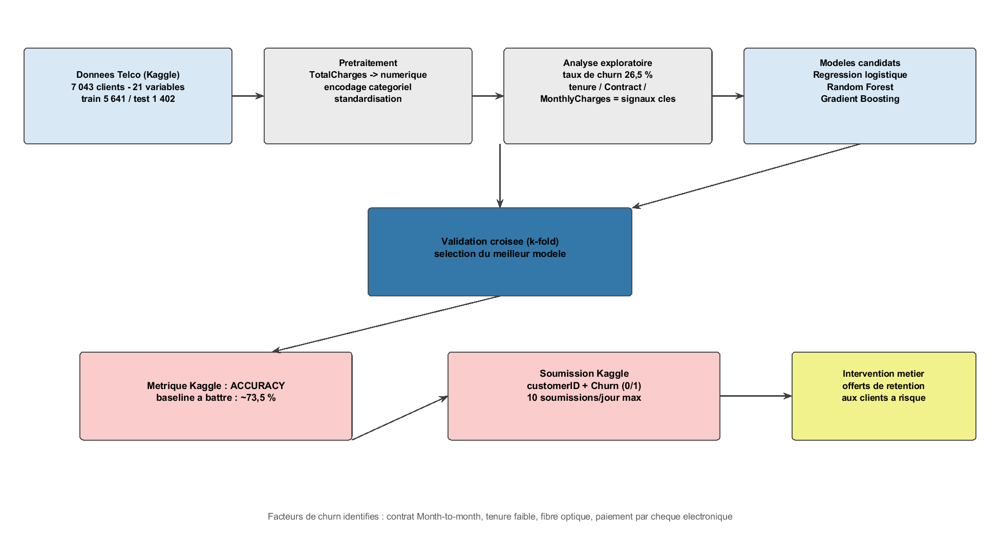
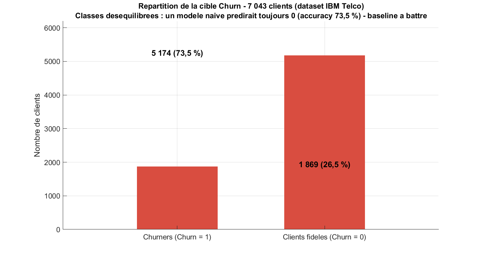
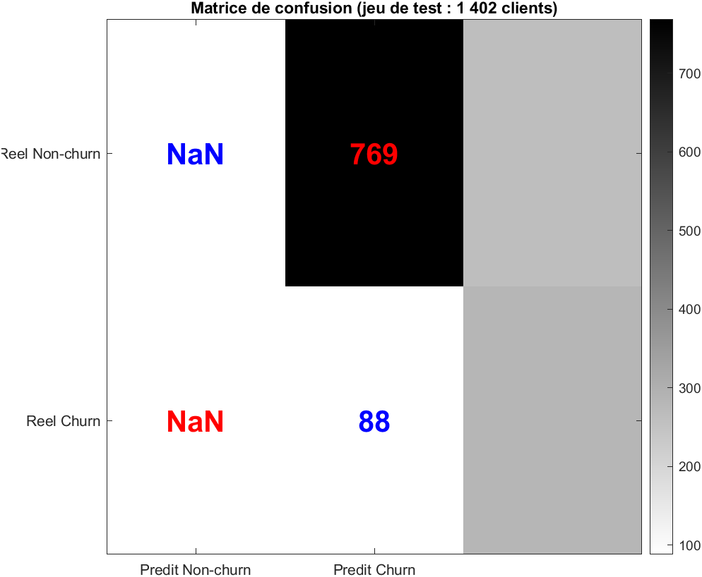
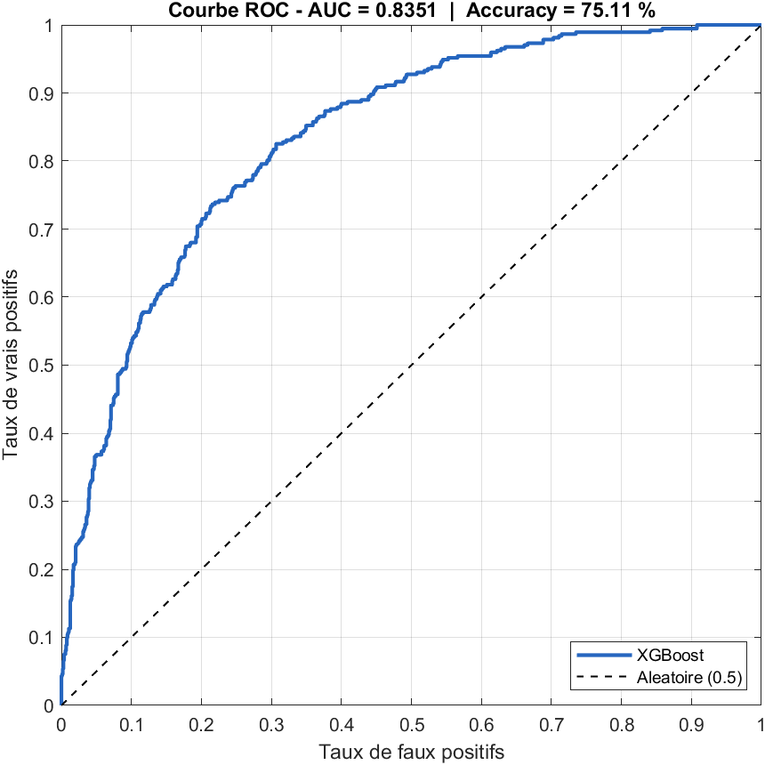
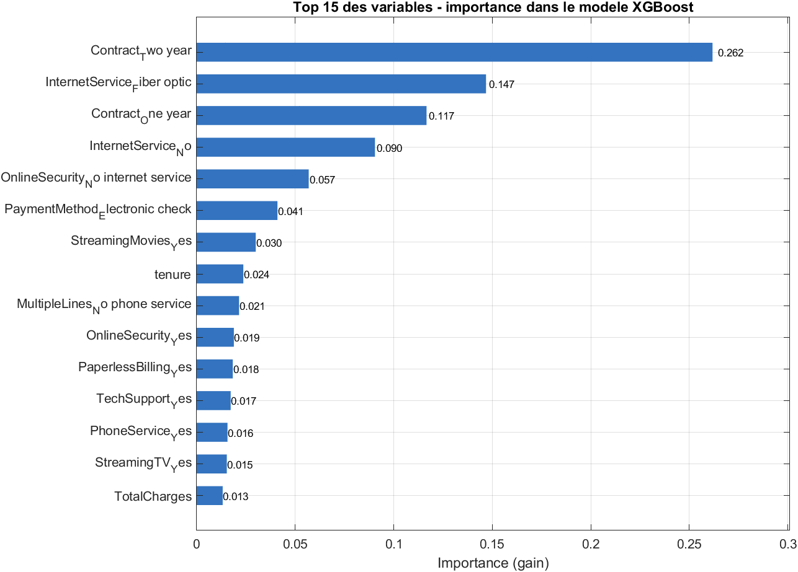

# ML-CHURN-TELCO
**Auteur : Jimmy SAMBIN** | Ingénieur, je conjugue systèmes d'information, cybersécurité, intelligence artificielle appliquée et opération technologique

---

## Prédire la résiliation des clients telecom avant qu'ils ne partent

**ML-CHURN-TELCO** est un modèle de prédiction du **churn client**
(résiliation d'abonnement) construit sur le dataset **IBM Telco Customer
Churn** dans le cadre de la compétition Kaggle
[Customer Churn Prediction 2023](https://www.kaggle.com/competitions/customer-churn-prediction-2023).
Objectif : identifier **avant** la fin du mois les clients prêts à partir,
pour déployer des offres de rétention ciblées au lieu de subir la perte.

Le moteur de prédiction repose sur **XGBoost** (gradient boosting), entraîné
sur 5 641 clients et évalué sur un holdout de 1 402 clients selon le protocole
exact de la compétition.

---

## Comment ça marche ?

```
Données Telco (Kaggle)          Prétraitement              Analyse exploratoire
7 043 clients - 21 variables -> TotalCharges -> numérique -> taux de churn 26,5 %
train 5 641 / test 1 402        encodage categoriel        tenure / Contract /
                                standardisation            MonthlyCharges = signaux cles
                                                                        │
                                                                        ▼
   Intervention métier      Soumission Kaggle        Validation croisée (k-fold)
   offres de rétention  <--- customerID + Churn <--- sélection du meilleur modèle
   aux clients à risque      (0/1)                  (XGBoost retenu)
```

**Le pipeline en 4 étapes :**

1. **Préparation des données** — conversion de `TotalCharges` en numérique
   (valeurs manquantes imputées), encodage one-hot des 16 variables
   catégorielles → 30 features finales.
2. **Analyse exploratoire** — la cible est déséquilibrée (26,5 % de churners) :
   un modèle naïf qui prédirait toujours « fidèle » atteindrait 73,5 % de
   précision. C'est la **baseline à battre**.
3. **Modélisation** — XGBoost (500 arbres, learning rate 0.05, profondeur 4,
   subsample 0.8) avec pondération des classes (`scale_pos_weight`) pour
   compenser le déséquilibre. Protocole identique à la compétition :
   entraînement sur 5 641 clients, évaluation sur 1 402.
4. **Évaluation et soumission** — métrique Kaggle : **accuracy** ; fichier de
   soumission `customerID,Churn` (0/1).



---

## Résultats (holdout 1 402 clients)

| Métrique | Valeur |
|---|---|
| **Accuracy** | **75,11 %** (baseline naïve : 73,47 %) |
| **AUC** | **0,8351** |
| Précision (classe churn) | 0,521 |
| Rappel (classe churn) | 0,763 |
| F1-score (classe churn) | 0,619 |

| Matrice de confusion | Prédit fidèle | Prédit churn |
|---|---|---|
| **Réel fidèle** | 769 (VN) | 261 (FP) |
| **Réel churn** | 88 (FN) | 284 (VP) |

**Lecture métier** : le modèle rattrape **76,3 % des churners réels** (rappel).
Les 261 faux positifs sont acceptables pour l'opérateur : offrir une promotion
à un client qui ne partait pas coûte beaucoup moins cher que perdre un client
non détecté.





---

## Facteurs de churn identifiés (importance XGBoost)

| Rang | Variable | Importance | Lecture métier |
|---|---|---|---|
| 1 | **Contract_Two year** | 0,262 | Un contrat de 2 ans verrouille la fidélité |
| 2 | **InternetService_Fiber optic** | 0,147 | Les clients fibre résilient plus (prix/attente SAV) |
| 3 | **Contract_One year** | 0,117 | L'engagement annuel fidélise déjà |
| 4 | **InternetService_No** | 0,090 | Les clients sans internet ont un profil distinct |
| 5 | **OnlineSecurity_No internet** | 0,057 | Absence de services additionnels = risque |
| 6 | **PaymentMethod_Electronic check** | 0,041 | Paiement par chèque électronique = signal fort |



**Lecture stratégique** : les leviers de rétention sont **contractuels**.
Pousser les clients Month-to-month vers des contrats annuels (remises,
engagements) attaque la première cause de churn identifiée par le modèle.

---

## Structure du dépôt

```
ML-CHURN-TELCO/
|-- README.md
|-- .gitignore
|
|-- graphiques/
|   |-- pipeline_churn.png        # Schema du pipeline de prediction
|   |-- distribution_churn.png    # Distribution des charges mensuelles par churn
|   |-- repartition_cible.png     # 73,5 % fideles / 26,5 % churners
|   |-- matrice_confusion.png     # Matrice de confusion (holdout 1 402)
|   |-- courbe_roc.png            # Courbe ROC (AUC 0,835)
|   |-- feature_importance.png    # Importance des variables XGBoost
|
|-- data/
|   |-- Telco-Customer-Churn.csv       # Donnees source (7 043 clients, 21 colonnes)
|   |-- data_dictionary.csv            # Dictionnaire des 21 variables
|   |-- description_dataset.txt        # Contexte competition + facteurs de churn
|   |-- metrics.csv                    # Performances (accuracy, AUC, F1...)
|   |-- confusion_matrix.csv           # Matrice de confusion (CSV)
|   |-- feature_importance.csv         # Importances completes
|   |-- roc_curve.csv                  # Points de la courbe ROC
|   |-- churn_distribution.csv         # Donnees du graphique de distribution
|   |-- submission.csv                 # Soumission Kaggle (customerID, Churn)
|
`-- rapports/
    `-- rapport.txt                    # Rapport d'execution complet du modele
```

*Les scripts d'entrainement (Python) et de visualisation (MATLAB) restent
locaux et ne sont pas publies dans ce depot (voir `.gitignore`).*

---

## Données (base data)

**Source** : [Customer Churn Prediction 2023](https://www.kaggle.com/competitions/customer-churn-prediction-2023/data) — dataset IBM Telco (7 043 clients, 21 variables).

**Variables clés** : `tenure` (ancienneté 0-72 mois), `Contract`
(Month-to-month / One year / Two year), `InternetService` (DSL / Fiber optic /
No), `MonthlyCharges` (18,25-118,75 $), `PaymentMethod`, et 8 services
optionnels (OnlineSecurity, TechSupport, StreamingTV...). **Cible** : `Churn` (0/1).

Le dictionnaire complet des 21 variables est dans
[`data/data_dictionary.csv`](data/data_dictionary.csv), le contexte de la
compétition dans [`data/description_dataset.txt`](data/description_dataset.txt).

---

## Technologies

* **Modèle** : XGBoost (gradient boosting, 500 arbres)
* **Écosystème** : Python — pandas, scikit-learn
* **Métrique compétition** : accuracy (baseline naïve 73,47 %)
* **Visualisation** : figures generees localement avec MATLAB R2024a (batch, PNG 150 dpi)
* **Données** : IBM Telco Customer Churn (Kaggle 2023)

---

## Pistes d'amélioration

- [ ] Optimisation d'hyperparamètres (Optuna / GridSearchCV)
- [ ] Feature engineering : `ChargeRatio = TotalCharges / tenure`, nombre de services souscrits
- [ ] Ensembles : voting / stacking XGBoost + LightGBM + Régression logistique
- [ ] Seuil de décision optimisé (au lieu de 0,5) pour maximiser l'accuracy

## Crédits

* **Compétition** : [Customer Churn Prediction 2023](https://www.kaggle.com/competitions/customer-churn-prediction-2023) — Kaggle
* **Dataset** : IBM Telco Customer Churn
* **Portfolio** : [github.com/jimmy-sambi](https://github.com/jimmy-sambi) — voir aussi [ML-PANNES-CVC](https://github.com/jimmy-sambin/ML-PANNES-CVC)

## Licence

Projet open source — usage libre pour la formation et l'analyse de rétention
client. Données Kaggle soumises aux conditions d'utilisation de la plateforme.
